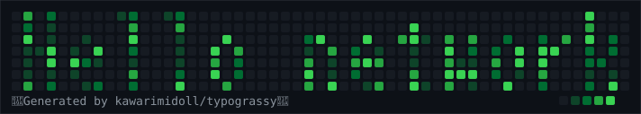
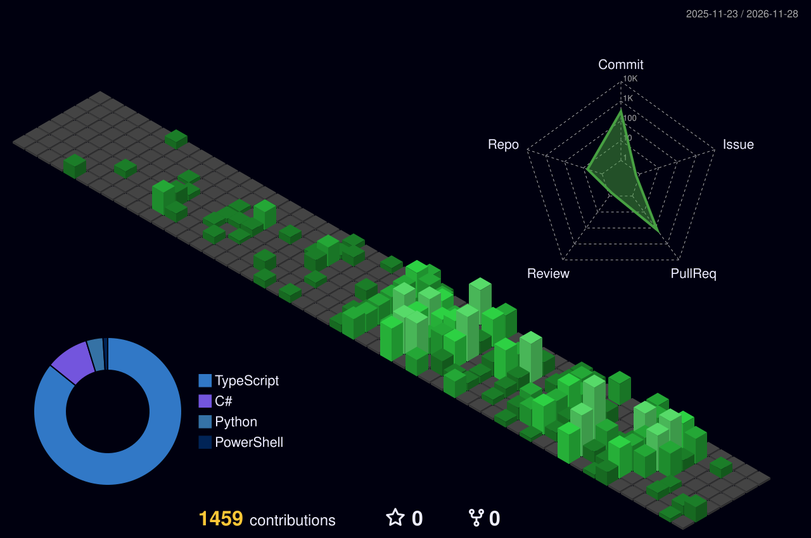

<!-- 1. 流れるメッセージ（typograssy で作った SVG。文字を変えたいときは profile/typograssy.svg を差し替え） -->

<!-- 2. Hi There -->
##  𝙷𝚒 𝚃𝚑𝚎𝚛𝚎

 

𝗸𝘆𝗼𝗻 
𝙸'𝚖 𝚊𝚗 𝙸𝚗𝚏𝚛𝚊𝚜𝚝𝚛𝚞𝚌𝚝𝚞𝚛𝚎 𝙴𝚗𝚐𝚒𝚗𝚎𝚎𝚛 𝚙𝚊𝚜𝚜𝚒𝚘𝚗𝚊𝚝𝚎 𝚊𝚋𝚘𝚞𝚝 𝙽𝚎𝚝𝚠𝚘𝚛𝚔 & 𝚂𝚎𝚌𝚞𝚛𝚒𝚝𝚢! 
𝙸 𝚕𝚒𝚔𝚎 𝚋𝚞𝚒𝚕𝚍𝚒𝚗𝚐 𝚑𝚊𝚗𝚍𝚢 𝚝𝚘𝚘𝚕𝚜 𝚏𝚘𝚛 𝚎𝚟𝚎𝚛𝚢𝚍𝚊𝚢 𝚘𝚙𝚜. ☺︎

𝙸𝚏 𝚢𝚘𝚞'𝚛𝚎 𝚒𝚗𝚝𝚎𝚛𝚎𝚜𝚝𝚎𝚍 𝚒𝚗 𝚖𝚢 𝚠𝚘𝚛𝚔𝚜, 𝚏𝚎𝚎𝚕 𝚏𝚛𝚎𝚎 𝚝𝚘 𝚌𝚑𝚎𝚌𝚔 𝚘𝚞𝚝 𝚖𝚢...

### 🛠️ [𝙈𝙮 𝙍𝙚𝙥𝙤𝙨𝙞𝙩𝙤𝙧𝙞𝙚𝙨](https://github.com/siroco-kyon?tab=repositories)  
> 𝘛𝘰𝘰𝘭𝘴 𝘐'𝘷𝘦 𝘣𝘶𝘪𝘭𝘵 𝘧𝘰𝘳 𝘦𝘷𝘦𝘳𝘺𝘥𝘢𝘺 𝘸𝘰𝘳𝘬 — 𝙒𝙞𝙣𝙙𝙤𝙬𝙨 𝙪𝙩𝙞𝙡𝙞𝙩𝙞𝙚𝙨, 𝙙𝙚𝙨𝙠𝙩𝙤𝙥 𝙖𝙥𝙥𝙨, 𝘢𝘯𝘥 𝙬𝙚𝙗 𝙩𝙤𝙤𝙡𝙨.

### ⭐ [𝙎𝙩𝙖𝙧𝙧𝙚𝙙 𝙍𝙚𝙥𝙤𝙨!](https://github.com/siroco-kyon?tab=stars)  
> 𝘗𝘳𝘰𝘫𝘦𝘤𝘵𝘴 𝘐'𝘮 𝘧𝘰𝘭𝘭𝘰𝘸𝘪𝘯𝘨 𝘢𝘯𝘥 𝙡𝙚𝙖𝙧𝙣𝙞𝙣𝙜 𝙛𝙧𝙤𝙢.

 

 

<!-- 3. 🚀Skills -->
<!-- ライトモード：theme=light, ダークモード：theme=dark -->
<!-- アイコン一覧：https://github.com/tandpfun/skill-icons#icons-list -->

<!-- skillicons に無いものは shields.io のバッジで追加 -->
 

 
 

<!-- 4. 📈GitHub Activities（.github/workflows/update-profile.yml が毎日自動で再生成） -->
##  𝙶𝚒𝚝𝙷𝚞𝚋 𝙰𝚌𝚝𝚒𝚟𝚒𝚝𝚒𝚎𝚜
  
  

  

 𝙲𝚞𝚛𝚛𝚎𝚗𝚝𝚕𝚢 𝚜𝚝𝚞𝚍𝚢𝚒𝚗𝚐 𝚏𝚘𝚛 𝙲𝙲𝙽𝙰 & 𝚊𝚕𝚠𝚊𝚢𝚜 𝚎𝚡𝚙𝚕𝚘𝚛𝚒𝚗𝚐 𝚗𝚎𝚠 𝚝𝚎𝚌𝚑!

 
<!-- 1番下のやつ -->

### 𝚃𝚑𝚊𝚗𝚔 𝚢𝚘𝚞 𝚏𝚘𝚛 𝚟𝚒𝚜𝚒𝚝𝚒𝚗𝚐! 

  

<!-- X(Twitter) を載せるときは下のコメントを外して yourid を書き換え -->
<!--  -->

